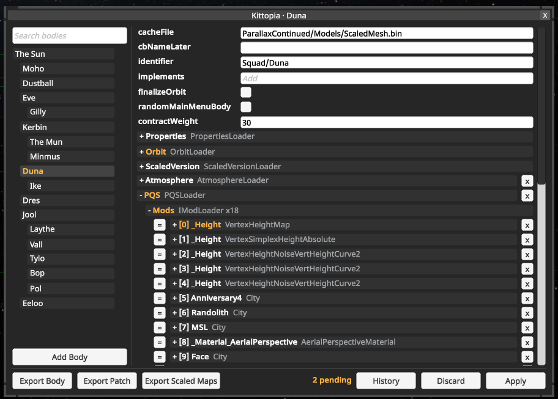

# KittopiaTech

Kittopia is a visual editor for Kopernicus. It allows you to live-edit just
about anything you can configure through kopernicus configs.

Some examples of what you can do:
* Modify the terrain in real-time by adding or editing PQSMods.
* Change the textures used by the scaled space model of a planet.
* Inspect any configured texture used by a body.
* Add or edit the ring system on a planet.
* Delete Dres.
* Create 17 different copies of Dres, each with slightly different orbits and
  unique ring systems.

To open the kittopia editor open up the Alt+F12 debug menu, then click on the
kittopia tab. It will open up the editor above, which you can then use to edit
any body you chose.

You can find more complete docs about how to user each editor component in the
[user guide](./docs/user-guide.md).

## Extending Kittopia
Kittopia was built to be extensible. You can define your own custom field
editors, config writers, or apply hooks so that your types can be edited just
as easily as any type built into kopernicus.

Take a look at the [extending kittopia](./docs/extending.md) guide for more.

## Dependencies
Kittopia depends on the following mods:
* Kopernicus
* KSPTextureLoader

If you want to export scaled space textures for a planet then you will also
need BurstPQS. Kittopia does not include support for doing this natively
(and BurstPQS is way faster anyways).

In addition, Kittopia has full support for HotReloadKSP. You can use this to
edit the code for PQSMods as you go, and it will continue being able to edit
planet surfaces (and update the editor) as changes are reloaded.

## Building and Contributing
See [CONTRIBUTING.md](./CONTRIBUTING.md).

## License
Kittopia is available under the MIT license.
