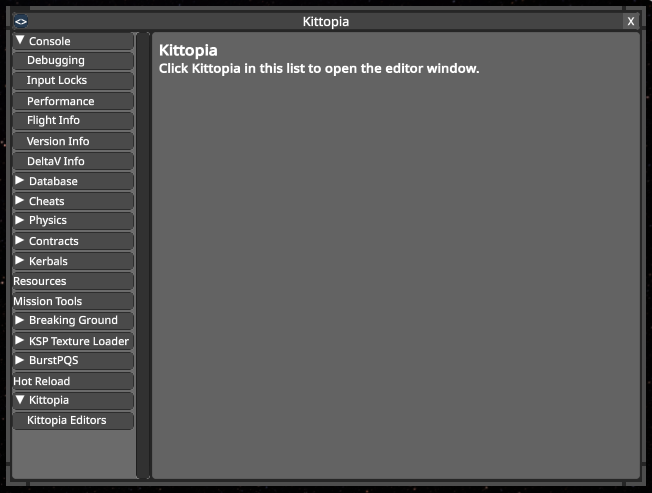
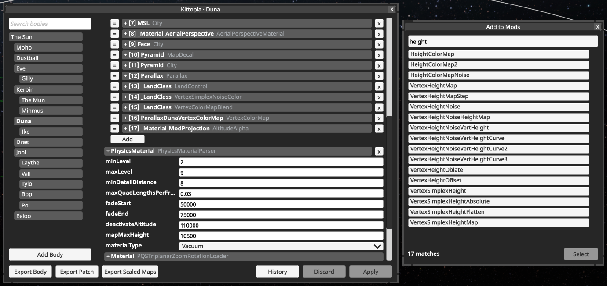
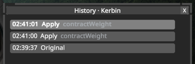
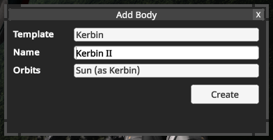
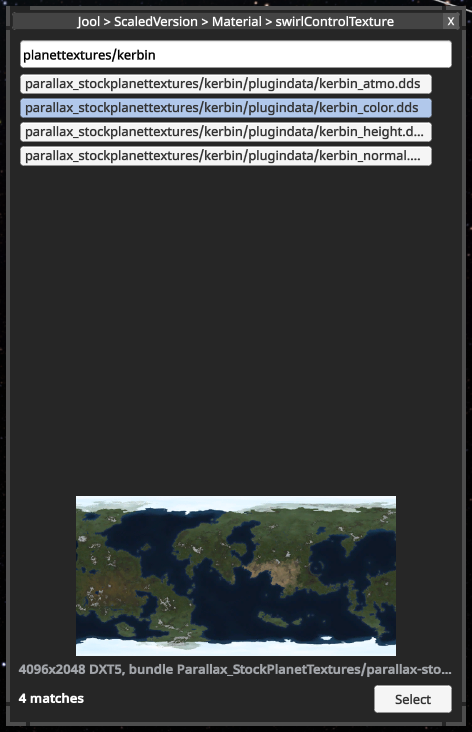
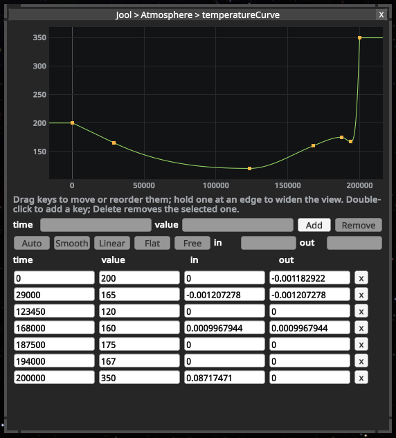
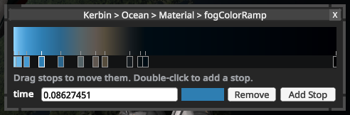
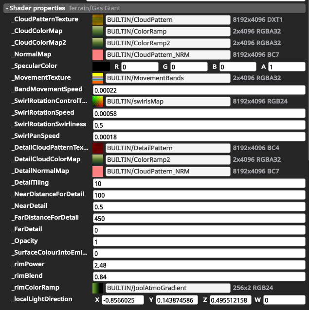

# Using KittopiaTech
Open the Alt+F12 menu and click Kittopia, in any scene from the main menu onwards. Pick a
body on the left (type in the box above the list to filter it) and edit its Kopernicus
configuration on the right.

Edits are staged: changed rows turn amber, and nothing happens to the planet until you press
Apply. Discard throws away everything that hasn't been applied.

## Keeping your changes
Applied changes only last until the game closes. To keep them, export the body:

- **Export Body** writes the whole body as a Kopernicus config.
- **Export Patch** writes a ModuleManager patch with only what you changed.

Both write `PluginData/Kittopia/<body>.cfg` in the KSP folder, replacing the body's last
export. The game doesn't load files there; move the file into `GameData` to use it.

## Editing
- Hover a field's label to see its documentation, where the mod that defines it provides
  any. Hover a localization key such as `#autoLOC_900101` to see what it says in game.
- Adding a node or list item, such as a ring, creates it straight away so you can edit it.
  Discard removes it again.
- Removing a node or item waits for Apply, and can be undone until then.
- In lists that hold several types, such as a PQS's Mods, Add opens a searchable list of
  types to pick from.

  
- Fields that name a body, such as the orbit's `referenceBody`, show a list of bodies when
  clicked. Applying a new `referenceBody` moves the body into orbit around it.

## History
History lists the body's last 40 Applies, newest first, under an Original entry for the body
as loaded. Click an entry to put the body back the way it was after that Apply; you can
step forward again until you apply something new. History is lost when the game closes.

Actions that ask for confirmation, such as Convert Body to Barycenter, can't be undone, and
you can't go back past them.

## Adding and deleting bodies
**Add Body**, under the body list, copies a body under a new name. Pick the body to copy as
its Template and, optionally, a different body for it to orbit. The copy leaves out what
other mods add to bodies (they configure bodies by name, so they don't know about the copy),
any space centre, and its template's UBIs.

**Delete Body**, at the bottom of a body's fields, removes it after a second click. Stars,
the home world, bodies with moons and bodies with vessels around them can't be deleted.

Like other edits, new and deleted bodies only last until the game closes. Don't save the
game with vessels around a new body: it won't be there when the save loads.

## Textures
Click a texture or map path to browse textures in GameData, in asset bundles and built into
the game (`BUILTIN/`). Click an entry to preview it, and double-click it or press Select to
use it. Click a thumbnail for a larger preview. Previews leave out alpha, since it often
holds something other than transparency, like gloss.

## Curves
Click a curve's graph button to open a larger graph. Drag keys to move them, double-click
empty space to add one, and press Delete to remove the selected key. Below the graph you can
type the selected key's time and value and pick its tangent mode:

- **Auto** lets KSP choose the tangents.
- **Smooth** and **Linear** follow the neighbouring keys.
- **Flat** is level.
- **Free** keeps the tangents you type.

## Colour ramps
Rim and fog colour ramps are edited as gradients: click the ramp's button, drag the markers
to move stops, double-click to add one, and pick a stop's colour. A ramp loaded from a
texture is approximated by a few stops, and exports as a gradient once edited. To keep
using a texture, set the raw property (e.g. `_rimColorRamp`) under Shader properties.

## Materials and shaders
Each material has a Shader properties section listing every property of its shader by its
raw name, e.g. `_MainTex`. Hover one for its description and range. Toggle-style properties
show as checkboxes or dropdowns.

For shaders Kopernicus has no loader for, such as a planet pack's own, you can click the
shader's name to switch to another shader. Their Keywords list shows the shader keywords
that are on; to turn on one that isn't listed, type its name under the list and press Add.

## Scaled space maps
With [BurstPQS](https://github.com/Phantomical/BurstPQS) installed, Export Scaled Maps opens
its Texture Exporter with the current body selected, for exporting height, colour and normal
maps.
